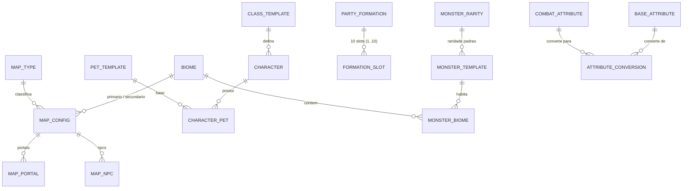

# 🗄️ Modelagem do Banco de Dados Low-Code & Procedural (Etheria Campus)

> **REGRA DA CURADORIA ("WHITELIST"):**
> Nenhum mapa, personagem, monstro, montaria, NPC, item ou habilidade do repositório `mcrework` existe no jogo automaticamente.
> Um elemento só passa a existir no **Etheria Campus** quando é adicionado em uma das tabelas abaixo através da **Rota `/admin`**.

---

## 1. Diagrama de Tabelas Principais

---

## 2. Especificação das Tabelas Low-Code (Para Edição no `/admin`)

### 2.1. Módulo de Mundo & Mapas Procedurais
* **`biomes` (Biomas):**
  * `id`, `code` (ex: `JUNGLE`, `WOODS`, `FOREST`, `DESERT`, `SWAMP`, `VOLCANO`, `GLACIER`, `RUINS`), `name_i18n_key`, `elemental_modifiers` (JSON).
* **`map_types` (Tipos de Zona):**
  * `id`, `code` (`CITY`, `VILLAGE`, `SUBURB`, `DUNGEON`, `HOSTILE_ZONE`, `CONFLICT_ZONE`), `name_i18n_key`, `pvp_enabled` (boolean), `allow_encounters` (boolean), `encounter_rate_per_step` (float), `min_monsters_per_encounter` (1..10), `max_monsters_per_encounter` (1..10), `exp_multiplier`, `drop_multiplier`.
* **`maps` (Mapas Curados pelo Admin):**
  * `id`, `mcrework_map_folder` (ex: `map1`, `map15` — selecionado visualmente do `mcrework`), `name_i18n_key`, `order_index` (1, 2, 3... calcula nível mínimo de 10 em 10: `1, 10, 20, 30...`), `custom_min_level` (nullable), `level_variance_min` (ex: `-2`), `level_variance_max` (ex: `+5`), `primary_biome_id`, `secondary_biome_id`, `map_type_id`, `is_active`.
* **`map_portals` (Portais editáveis no Mapa):**
  * `id`, `source_map_id`, `source_x`, `source_y`, `radius`, `target_map_id`, `target_x`, `target_y`, `vfx_asset_key`.
* **`map_npcs` (Posicionamento de NPCs no Mapa):**
  * `id`, `map_id`, `npc_template_id`, `pos_x`, `pos_y`, `direction` (0..7).

### 2.2. Módulo de Atributos Procedurais (Base $\rightarrow$ Combate)
* **`base_attributes` (Atributos Base):**
  * `code` (`VIT`, `STR`, `INT`, `AGI`, `DEX`, `WIL`), `name_i18n_key`, `description_i18n_key`.
* **`combat_attributes` (Atributos Derivados de Combate):**
  * `code` (`MAX_HP`, `MAX_MP`, `PHYS_ATK`, `MAG_ATK`, `PHYS_DEF`, `MAG_DEF`, `SPEED`, `CRIT_RATE`, `CRIT_DMG`, `EVASION`, `ACCURACY`, `STARTING_AP`, `AP_PER_TURN`), `name_i18n_key`, `base_default_value`, `is_percentage`.
* **`attribute_conversions` (Matriz Procedural de Derivação):**
  * `id`, `base_attribute_code`, `combat_attribute_code`, `points_per_unit` (Ex: `1 VIT -> +20 MAX_HP`, `1 VIT -> +1.5 PHYS_DEF`).
* **`global_formulas` (Fórmulas Gerais parametrizadas):**
  * `key` (ex: `MAP_MIN_LEVEL_FORMULA`, `MONSTER_LEVEL_SCALING_CURVE`, `PARTY_PET_LIMIT_SOLO_DUO`, `PARTY_PET_LIMIT_TRIO_PLUS`), `expression_json`, `description`.

### 2.3. Módulo de Classes, Monstros, Pets e Formação de 10 Slots
* **`class_templates` (Classes/Skins de Personagens):**
  * `id`, `mcrework_char_key` (escolhido da pasta `characters` do `mcrework`), `name_i18n_key`, `gender`, `initial_base_attributes` (JSON), `attributes_per_level` (JSON), `available_skill_ids` (JSON).
* **`monster_rarities` (Raridades de Monstros):**
  * `id`, `code` (`COMMON`, `UNCOMMON`, `ELITE`, `RARE`, `MINIBOSS`, `BOSS`), `stat_multiplier`, `exp_multiplier`, `drop_multiplier`, `visual_scale_multiplier`, `spawn_weight`.
* **`monster_templates` (Monstros e Pets Curados):**
  * `id`, `mcrework_monster_key` (escolhido da pasta `monsters` do `mcrework`), `name_i18n_key`, `monster_type` (`BEAST`, `PLANT`, `UNDEAD`, `ELEMENTAL`, `DEMON`, `DRAGON`, `HUMANOID`), `default_rarity_id`, `is_tamable_as_pet` (boolean), `preferred_arena_row` (`FRONTLINE` | `BACKLINE`), `base_attributes_seed` (JSON: pesos de VIT, STR, INT, AGI...), `skill_ids` (JSON), `loot_table_id`.
* **`monster_biomes` (Vínculo Monstro $\leftrightarrow$ Biomas):**
  * `monster_template_id`, `biome_id` (Determina em quais mapas o monstro pode nascer proceduralmente).
* **`arena_formations` (Formação Tática dos 10 Slots):**
  * `id`, `owner_id` (Jogador Solo ou Grupo/Capitão), `slot_1` a `slot_5` (Vanguarda), `slot_6` a `slot_10` (Retaguarda) — valida automaticamente a regra:
    * **Solo ou Dupla:** até `1 Personagem + 3 Pets` por jogador.
    * **3 a 5 Jogadores:** no máximo `1 Personagem + 1 Pet` por jogador.

### 2.4. Módulo de Habilidades (Skills), Efeitos (VFX) e Equipamentos
* **`skill_templates` (Habilidades de Combate 5B):**
  * `id`, `name_i18n_key`, `mcrework_icon_key` (`skills/icons/`), `cast_action_id`, `mcrework_vfx_key` (`effects/`), `ap_cost` (Custo em Pontos de Turno), `cooldown_turns`, `range_rule` (`MELEE_FRONTLINE`, `RANGED_ANY`, `PIERCE_ROW`, `COLUMN`, `CROSS`, `ALL_ENEMIES`, `ALLY_SINGLE`, `ALLY_ALL`), `scaling_formula` (JSON: ex: `1.5 * PHYS_ATK`), `status_effect_json`.
* **`item_templates` (Armas, Equipamentos e Consumíveis):**
  * `id`, `name_i18n_key`, `mcrework_icon_key` (`equipment/`), `slot_type` (`WEAPON`, `HELMET`, `ARMOR`, `BOOTS`, `NECKLACE`, `RING`, `MOUNT`, `CONSUMABLE`), `required_level`, `base_attribute_bonuses` (JSON), `combat_attribute_bonuses` (JSON), `set_id`.
* **`i18n_translations` (Traduções Dinâmicas do Banco):**
  * `key`, `locale` (`pt-BR`, `en-US`, `es-ES`), `text`.
